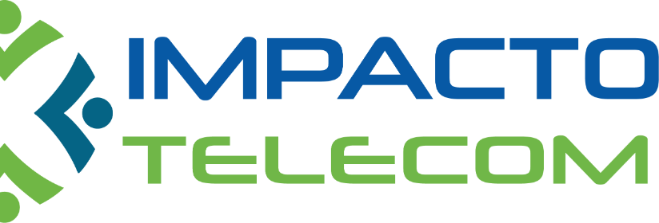

  

<h1 align="center">Impacto Telecom</h1>

  <strong>Internet fibra óptica em Atibaia e região</strong> 
  <em>Você merece uma internet de Impacto</em>

  
  
  
  

  
  
  
  

  
  
  
  

  Sob gestão da <a href="https://nexthop.solutions"><strong>NextHop Solutions®</strong></a>
  &nbsp;/&nbsp;
  <a href="https://nexthop.solutions"><strong>Elizandro Pacheco</strong></a>

---

## Sobre

A **Impacto Telecom** é um provedor regional de internet fibra óptica com sede em Atibaia, no interior de São Paulo. Atende residências, empresas e outros provedores da região com rede 100% fibra, Wi-Fi 6, suporte técnico local e operação 24/7.

> Site: [impactotelecom.com](https://impactotelecom.com)

## Rede

Operamos o **AS264212** como ISP regional e também como trânsito para provedores da região. Presença em IX.br São Paulo e Equinix, com política de peering aberta.

| | |
| :--- | :--- |
| **ASN** | [AS264212](https://www.peeringdb.com/asn/264212) |
| **IRR AS-SET** | `AS264212:AS-CONE` |
| **Tráfego** | 100–200 Gbps |
| **IX** | [IX.br São Paulo](https://ix.br) · 100G |
| **Facilities** | Equinix SP1 (São Paulo) · Equinix SP4 (Barueri) |
| **Looking Glass** | [lg.impactotelecom.com](http://lg.impactotelecom.com) |
| **Peering** | Política aberta · [peering@impactotelecom.com](mailto:peering@impactotelecom.com) |
| **NOC 24/7** | [noc@nexthop.solutions](mailto:noc@nexthop.solutions) |

## Gestão

Esta organização no GitHub e a operação de rede da Impacto Telecom estão sob gestão da **[NextHop Solutions®](https://nexthop.solutions)** / **[Elizandro Pacheco](https://nexthop.solutions)**.

A NextHop Solutions® é consultoria especializada para provedores de acesso: trânsito IP, mitigação anti-DDoS, inteligência de redes e operação de NOC.

  
  
  

## Contato

| Canal | |
| :--- | :--- |
| **Site** | [impactotelecom.com](https://impactotelecom.com) |
| **Atendimento** | 0800 123 4040 · (11) 9 9877-0025 |
| **Peering** | [peering@impactotelecom.com](mailto:peering@impactotelecom.com) |
| **NOC** | [noc@nexthop.solutions](mailto:noc@nexthop.solutions) |
| **PeeringDB** | [AS264212](https://www.peeringdb.com/asn/264212) |
| **LinkedIn** | [impacto-telecom](https://br.linkedin.com/company/impacto-telecom) |
| **Instagram** | [@impactotelecomoficial](https://www.instagram.com/impactotelecomoficial/) |
| **Gestão** | [nexthop.solutions](https://nexthop.solutions) |

  
    © Impacto Telecom · Gestão <a href="https://nexthop.solutions">NextHop Solutions®</a> / <a href="https://nexthop.solutions">Elizandro Pacheco</a>
  

